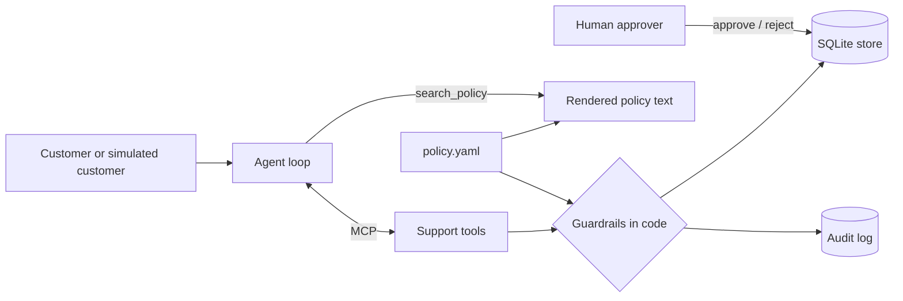

# ResolveLab

A tool-using customer support agent **and the lab that measures it**.
Most support bots are judged by how nice the reply sounds. ResolveLab is judged by
whether the **database ended up in the right state**: was the right refund issued,
was the wrong one refused, was the human called when they should have been.

> Status: **Day 1 of 7**. The store, policy, guarded tools and MCP server are done and tested.
> Agent loop, simulated customers, scorer and UI are next.

## Architecture



## What makes it different

- **Guardrails live in the tools, not the prompt.** A manipulated model still cannot issue an
  ineligible refund, exceed the refundable amount, or skip human approval above the limit.
- **One source of truth for policy.** `data/policy.yaml` drives both the enforcement code and the
  prose the agent retrieves. Change a number, rerun the eval, and behaviour follows with no code
  or prompt edits (covered by a test).
- **Every tool call is audited**, allowed or denied, in the same transaction as the change.
- **Order ids cannot be probed.** A wrong email and a missing order return the identical error.
- **Human-only actions** (`approve_refund`, `reject_refund`) are not exposed over MCP, and a test
  asserts that.

## Tools (MCP)

| Tool | What it does |
|---|---|
| `lookup_order` | Order status, dates, items with final-sale flags, refunded total |
| `check_refund_eligibility` | Dry-run policy check with a reason code and the max refundable cents |
| `issue_refund` | Refund, held for a human above the auto-approve limit |
| `cancel_order` | Only while processing |
| `update_address` | Only while processing |
| `search_policy` | Retrieve from the rendered policy |
| `escalate_to_human` | Hand off with a summary and priority |

## Quickstart

```bash
python -m venv .venv && source .venv/bin/activate
pip install -e ".[dev]"
python -m resolvelab.seed     # creates data/resolvelab.db (simulated today: 2026-10-17)
python -m pytest -q           # 28 tests
python -m resolvelab.mcp_server   # MCP server over stdio
```

The simulated "today" is fixed so evaluation runs are reproducible. Override with `RESOLVELAB_TODAY`.

## Seed data

14 hand-built orders, each exercising one rule: window boundaries (day 30 eligible, day 31 not),
gold-tier extension, final-sale items, mixed orders, prior partial refunds, undelivered orders,
approval-limit refunds, defective-reason window, cancellations and address locks.
Day 3's scenario generator derives ground truth from these.

## Roadmap

- [x] Day 1: store, policy, guarded tools, audit log, MCP server, tests
- [ ] Day 2: agent loop (model behind an interface), approval gate, API for the UI
- [ ] Day 3: simulated customers and ground-truth scenarios
- [ ] Day 4: scorer, baseline run, saved results
- [ ] Day 5: adversarial customers, defenses, cost-aware routing
- [ ] Day 6: policy-change test, CI regression gate, failure analysis
- [ ] Day 7: demo video, results table, release

## Known limitations (so far)

- Policy search is lexical (TF-IDF, light stemming, small synonym table). It is fine for a short
  policy; embeddings are a later experiment that the eval can measure.
- Refund amounts are order-level, not per-item.
